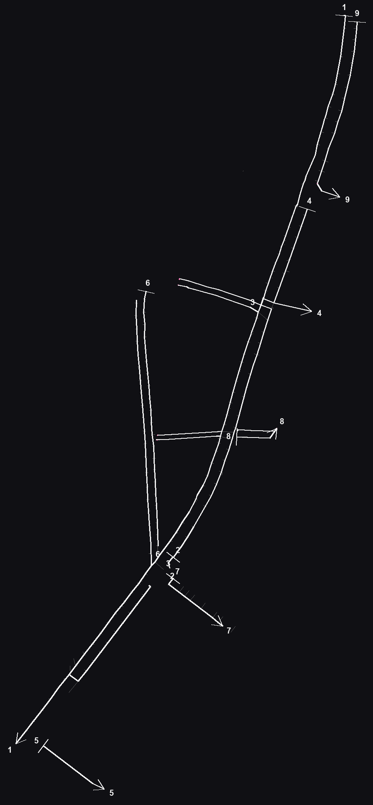

# pipe-flow-estimation 示例

对示例雨水管网图 `rain_only_test.dxf` 的 YSLINE 图层生成管线流向图。

## 提示词（skill 触发词示例）

```
为src_dxf/rain_only_test.dxf的YSLINE绘制flow
```

## 输入

- `rain_only_test.dxf` — 雨水管网图（YSLINE 管线 / LX 流向箭头 / CSK 出水口）

## 产出三件套

| 文件 | 说明 |
|---|---|
| `rain_only_test_flow.dxf` | 偏移 0.5m 的管线流向图：起点横断线、终点箭头、编号注记；白色 = LX 箭头定向，粉红 = 猜测 |
| `rain_only_test_flow.png` | 流向图预览 |
| `rain_only_test_flow.json` | 拓扑 JSON（管段、连通分量、主干/分支、node_offset、meta 标定参数） |



## 本例结果

- 提取 649 边、572 个 LX 箭头定向、6 个 CSK 出水口，异常边 0
- 拼接后 19 个连通分量；最大分量多汇点，自动拆树，最终 9 棵单出口树
- 9 个起点（横断线）、6 个 CSK 终点（箭头）、主干最长 2092.5m
- `validate.py` 验收全部 PASS（线宽统一、几何连通 9 群、横线⊥主干、箭头等翼、编号成对等）

## 复现

```bash
S=../../skills/pipe-flow-estimation/scripts; NET=rain_only_test.json
python3 $S/extract.py rain_only_test.dxf $NET --layer YSLINE
python3 $S/join.py   $NET $NET
python3 $S/trunk.py  $NET $NET
python3 $S/draw.py   $NET rain_only_test.dxf rain_only_test_flow.dxf
python3 $S/preview.py rain_only_test_flow.dxf $NET rain_only_test_flow.png
python3 $S/validate.py rain_only_test_flow.dxf rain_only_test_flow.json
```
